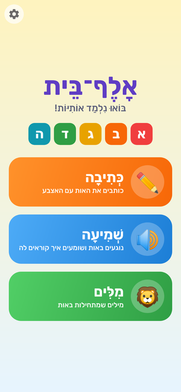
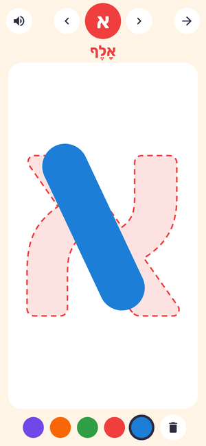
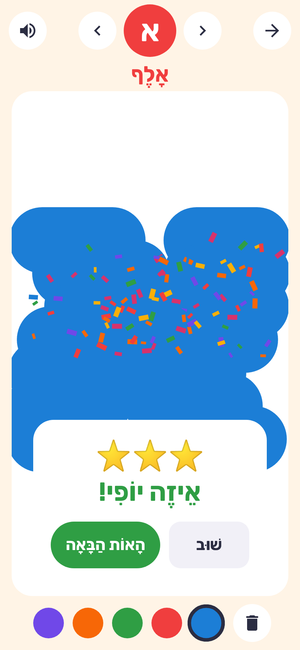
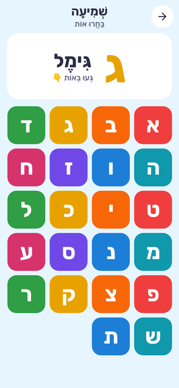
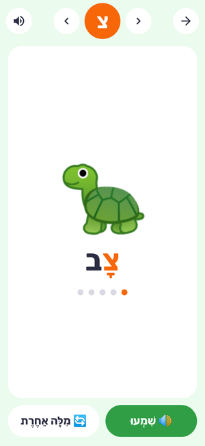

# אלף־בית · Hebrew Letters

An Android app that helps young children learn the Hebrew alphabet. Everything in it is in
Hebrew, laid out right-to-left, with big colourful buttons for small fingers.

**Download the app: [`apk/hebrew-letters.apk`](apk/hebrew-letters.apk)** (Android 6.0 or newer)

<p>





</p>

## What the child can do

1. **✏️ כְּתִיבָה (Writing).** Pick a letter and trace it with a finger over a big dotted
   letter. Five crayon colours, an eraser, and arrows to move to the next letter. When the
   letter is traced well, confetti falls, the phone cheers (כָּל הַכָּבוֹד!) and the letter gets a
   ⭐ in the letter grid. The app checks that most of the letter was covered without scribbling
   all over the screen, but it forgives a wobbly hand.
2. **🔊 שְׁמִיעָה (Listening).** Tap any letter and the phone says its name ("הָאוֹת בֵּית"). The
   letter is also shown big with its name.
3. **🦁 מִלִּים (Words).** Pick a letter to see a picture and a word that starts with it, for
   example ב → 🍌 בָּנָנָה. The phone says the word, and the first letter is highlighted.
   "מִלָּה אַחֶרֶת" shows another word: there are 111 words, 3–6 per letter.

Names and words are shown **with niqqud**, which also tells the phone exactly how to
pronounce them (אָלֶף "alef" and not "elef").

## Installing on your phone

1. On the phone, open this page and tap
   [`apk/hebrew-letters.apk`](apk/hebrew-letters.apk), then **Download** (the ⋯ menu →
   *Download*, or *View raw*).
2. Open the downloaded file. Android asks to allow installing apps from your browser or Files
   app: tap **Settings**, turn on **Allow from this source**, go back, and tap **Install**.
3. If Google Play Protect warns that it doesn't know the developer, tap **More details →
   Install anyway**. The app asks for no permissions and doesn't use the internet.

## The voice

The app speaks with the phone's own text-to-speech engine, so the phone needs a **Hebrew
voice**. Most Android phones already have one through *Speech Services by Google*. If there is
no Hebrew voice, the app shows a message with buttons that open the right settings:

* Install **Speech Services by Google** from the Play Store (on Samsung phones the built-in
  engine has no Hebrew).
* In the phone's settings, under *Text-to-speech output*, choose it as the preferred engine and
  download the **Hebrew** language.

The ⚙️ button on the home screen opens a small parents' panel: test the voice, choose slow or
normal speech, open the voice settings, or reset the stars.

## Building it yourself

The project is a standard Android Studio project (Java, no extra libraries).

* **Android Studio:** open the folder and press *Run*.
* **Command line:** `./gradlew assembleDebug` (APK in `app/build/outputs/apk/debug/`).
* **Tests:** `./gradlew testDebugUnitTest`. The Robolectric tests open every screen, check
  what the phone says, and trace every letter (and check that scribbling doesn't count).
* **Without the Android SDK:** [`scripts/build-apk.sh`](scripts/build-apk.sh) builds a signed APK
  with the build tools packaged by Ubuntu/Debian:
  `sudo apt-get install aapt dalvik-exchange zipalign apksigner android-sdk-platform-23`.

GitHub Actions builds the app and runs the tests on every push (see the *Actions* tab; the
debug APK is attached to each run).

### About the signing key

Android only installs an update if it is signed with the same key as the installed app. The
APK in `apk/` is signed with a private key that is deliberately **not** in this public
repository. A copy you build yourself is signed with a different key, so uninstall the
existing app first (only the stars are lost). To sign release builds with your own key, put
your `.jks` file and a `keystore.properties` in `keystore/` (that folder is git-ignored):

```properties
storeFile=my-key.jks
storePassword=...
keyAlias=...
keyPassword=...
```

## Project layout

| Path | What it is |
| --- | --- |
| `app/src/main/java/.../Alphabet.java` | The letters, their names and the words (with emoji pictures) |
| `app/src/main/java/.../TraceView.java` | The tracing canvas and how a trace is scored |
| `app/src/main/java/.../Speech.java` | Text-to-speech in Hebrew, with fallback to Google's engine |
| `app/src/main/java/.../*Activity.java` | The screens |
| `app/src/test/` | Robolectric and JUnit tests |
| `apk/hebrew-letters.apk` | Ready-to-install app |

## Credits

* Font: [Rubik](https://github.com/googlefonts/rubik) by the Rubik Project Authors, under the
  SIL Open Font License ([`OFL.txt`](app/src/main/assets/fonts/OFL.txt)). It is bundled as
  static Bold and Medium instances, subset to Hebrew and basic Latin.
* Pictures are emoji, drawn by the phone's own emoji font.

---

## בעברית בקצרה

**אלף־בית** היא אפליקציה לילדים ללימוד האותיות:

* **כתיבה:** בוחרים אות וכותבים אותה עם האצבע מעל אות מנוקדת. כשהאות כתובה יפה מקבלים כוכב
  וקונפטי.
* **שמיעה:** נוגעים באות והטלפון אומר את שמה.
* **מילים:** בוחרים אות ורואים תמונה ומילה שמתחילה בה, והטלפון מקריא אותה.

**התקנה:** מורידים את הקובץ [`apk/hebrew-letters.apk`](apk/hebrew-letters.apk) בטלפון, פותחים
אותו ומאשרים "התקנה ממקור לא ידוע". אם מופיעה אזהרה של Play Protect, בוחרים "פרטים נוספים ←
להתקין בכל זאת".

**קול:** האפליקציה משתמשת במנוע הדיבור של הטלפון. אם אין קול בעברית, מתקינים את
"Speech Services by Google", בוחרים בו בהגדרות "המרת טקסט לדיבור" ומורידים את השפה עברית.
